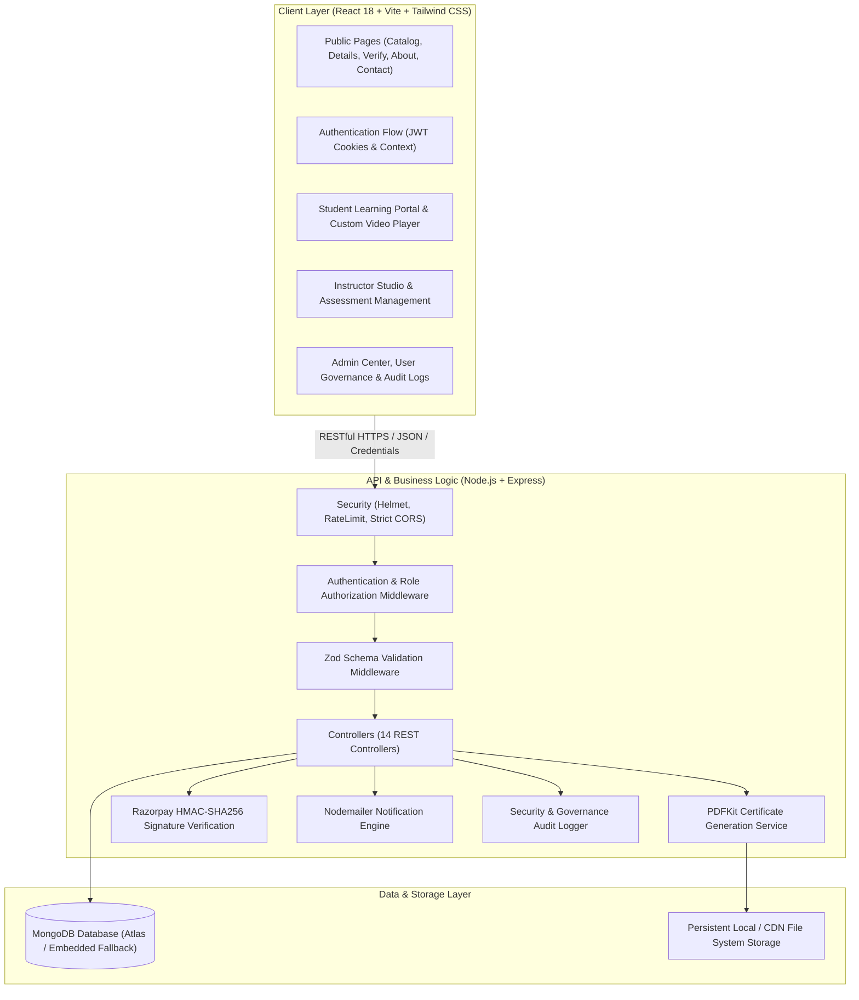

# EduSphere — Architectural Specification & Engineering Design

## 1. System Overview
EduSphere is a full-stack, enterprise-grade online education platform built on the MERN stack (MongoDB, Express, React, Node.js). It is engineered as a clean micro-modular monolith prioritizing maintainability, security, predictable state management, and seamless scalability.

The system supports three user personas:
- **Learners (Students)**: Course discovery, multi-filter catalog, video learning player with playback position persistence, interactive timed quizzes, capstone assignments, and tamper-proof PDF certifications.
- **Instructors**: Course draft authoring, section & lesson builder, assessment management, assignment submissions grading with custom rubric marks and feedback.
- **Administrators**: Platform metrics and KPIs, user identity lifecycle governance (activation/suspension), course approval workflow, category management, review moderation, and tamper-evident audit logging.

---

## 2. Architecture Diagram

---

## 3. Core Architectural Modules

### 3.1 Security & Authentication Architecture
- **Cryptographic Password Hashing**: Passwords hashed with `bcryptjs` using a salt work factor of 10.
- **Two-Tier JWT Token Strategy**: Short-lived Access Tokens (1 day) combined with rotating Refresh Tokens (7 days).
- **HTTP-Only Cookies**: Authentication tokens are transmitted in `httpOnly`, `sameSite`, and `secure` cookies, defending against Cross-Site Scripting (XSS).
- **Strict Role-Based Access Control (RBAC)**: Enforced server-side via `protect` and `authorize('student', 'instructor', 'admin')` middlewares. Even if client-side code is altered, unpermitted endpoints return `403 Forbidden`.
- **Public Admin Registration Prevention**: Public registration requests containing `role: 'admin'` are strictly rejected at the Zod schema boundary.
- **NoSQL Injection & Parameter Sanitization**: Request bodies, parameters, and queries are parsed through strict Zod schemas before touching Mongoose models.

### 3.2 Video Learning & Progress Engine
- **Playback Persistence**: Video current timestamp is periodically synced to the server every 5 seconds.
- **Lesson Completion**: Server calculates `percentCompleted = (completedLessons.length / totalLessons) * 100`.
- **Protected Stream Access**: Complete lesson details and media URLs are only returned if the student is actively enrolled, or if the user is the course instructor or an administrator.

### 3.3 Assessment & Evaluation Engine
- **Zero-Leak Question Distribution**: Correct answers (`isCorrect`) and explanatory annotations are stripped on the server before transmitting questions to students.
- **Server-Side Grading**: Score calculations, percentages, and pass/fail verdicts are computed strictly on the backend.
- **Attempt & Timing Boundaries**: Maximum attempt limits and time limits are validated server-side.

### 3.4 Cryptographic Certificate Pipeline
- **Verification Guarantee**: Generated exclusively upon achieving 100% course milestone completion.
- **Unique Identification**: Generates a tamper-proof certificate ID matching the format `EDU-YYYY-XXXXXX`.
- **Vector PDF Generation**: Built server-side using `PDFKit`, decorated with institutional borders, student details, course title, instructor signatures, and direct public verification links.
- **Public Credential Ledger**: Enables employers and institutions to verify credential authenticity in real-time via `GET /api/v1/certificates/verify/:certificateId`.

### 3.5 Indian Payment Architecture (Razorpay)
- **Two-Step Verification**: Order initialization on backend (`createRazorpayOrder`) followed by cryptographic signature verification (`HMAC-SHA256`) before committing enrollment.
- **Idempotency**: Prevents double-charging and duplicate enrollment records.
