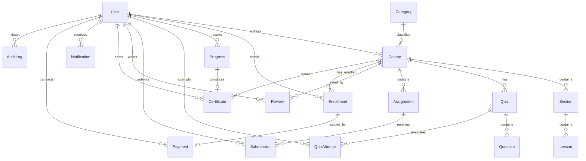

# EduSphere Database Architecture & Entity Relationship Design

## 1. Overview
EduSphere uses MongoDB with Mongoose ODM to model an educational SaaS ecosystem. The data model balances normalization (via ObjectId references) with selective embedding (for sub-documents such as question options and lesson resources) to achieve high read throughput and query efficiency.

---

## 2. Entity-Relationship Diagram

---

## 3. Schema Catalog & Key Indexes

### 1. `User`
- **Fields**: `name`, `email` (unique, indexed), `password` (select: false), `role` (`student`, `instructor`, `admin`), `avatar`, `headline`, `bio`, `status` (`active`, `suspended`), `isVerified`, `verificationToken`, `resetPasswordToken`, `resetPasswordExpires`.
- **Indexes**: `{ email: 1 }` (unique)

### 2. `Category`
- **Fields**: `name` (unique), `slug` (unique), `description`, `icon`, `courseCount`, `isActive`.
- **Indexes**: `{ slug: 1 }` (unique)

### 3. `Course`
- **Fields**: `title`, `slug` (unique), `subtitle`, `description`, `instructor` (ref User), `category` (ref Category), `difficulty`, `language`, `price`, `isFree`, `discountPrice`, `thumbnail`, `trailerVideoUrl`, `objectives`, `requirements`, `targetAudience`, `status` (`draft`, `pending`, `published`, `rejected`), `rejectionReason`, `totalDurationMinutes`, `totalLessons`, `ratingAverage`, `ratingCount`, `enrolledCount`.
- **Indexes**: `{ slug: 1 }` (unique), `{ status: 1, category: 1, difficulty: 1, price: 1 }`, `{ title: 'text', description: 'text' }`

### 4. `Section`
- **Fields**: `course` (ref Course), `title`, `description`, `orderIndex`.
- **Indexes**: `{ course: 1, orderIndex: 1 }`

### 5. `Lesson`
- **Fields**: `course` (ref Course), `section` (ref Section), `title`, `description`, `orderIndex`, `type` (`video`, `article`, `pdf`), `videoUrl`, `videoDurationSeconds`, `contentBody`, `resources`, `isPreviewAllowed`.
- **Indexes**: `{ section: 1, orderIndex: 1 }`, `{ course: 1 }`

### 6. `Enrollment`
- **Fields**: `student` (ref User), `course` (ref Course), `status` (`active`, `completed`, `refunded`), `enrolledAt`, `completedAt`, `pricePaid`, `payment` (ref Payment).
- **Indexes**: `{ student: 1, course: 1 }` (unique compound index prevents duplicate enrollment)

### 7. `Progress`
- **Fields**: `student` (ref User), `course` (ref Course), `completedLessons` (`[ref Lesson]`), `lessonProgress` (`[{ lesson, lastPositionSeconds, completedAt }]`), `percentCompleted`, `isCompleted`, `certificate` (ref Certificate).
- **Indexes**: `{ student: 1, course: 1 }` (unique compound index)

### 8. `Quiz`
- **Fields**: `course` (ref Course), `section` (ref Section), `title`, `description`, `durationMinutes`, `passingPercentage`, `maxAttempts`, `totalMarks`, `questionsCount`.
- **Indexes**: `{ course: 1 }`

### 9. `Question`
- **Fields**: `quiz` (ref Quiz), `questionText`, `questionType` (`single-choice`, `multiple-choice`), `options` (`[{ text, isCorrect }]`), `explanation`, `marks`, `orderIndex`.
- **Indexes**: `{ quiz: 1, orderIndex: 1 }`

### 10. `QuizAttempt`
- **Fields**: `quiz` (ref Quiz), `student` (ref User), `course` (ref Course), `answers`, `scoreAchieved`, `totalMarks`, `percentage`, `isPassed`, `timeSpentSeconds`, `attemptNumber`, `submittedAt`.
- **Indexes**: `{ quiz: 1, student: 1 }`

### 11. `Assignment`
- **Fields**: `course` (ref Course), `section` (ref Section), `title`, `instructions`, `totalMarks`, `passingMarks`, `deadline`, `referenceFiles`.
- **Indexes**: `{ course: 1 }`

### 12. `Submission`
- **Fields**: `assignment` (ref Assignment), `student` (ref User), `course` (ref Course), `submissionFiles`, `studentNotes`, `marksAwarded`, `feedback`, `status`, `submittedAt`, `gradedAt`, `gradedBy` (ref User).
- **Indexes**: `{ assignment: 1, student: 1 }`

### 13. `Review`
- **Fields**: `course` (ref Course), `student` (ref User), `rating` (1-5), `comment`, `isApproved`, `isReported`.
- **Indexes**: `{ course: 1, student: 1 }` (unique compound index: 1 review per student per course)
- **Hooks**: Automatically recalculates course average rating on save and delete.

### 14. `Certificate`
- **Fields**: `certificateId` (unique format `EDU-YYYY-XXXX`), `student` (ref User), `course` (ref Course), `studentName`, `courseTitle`, `instructorName`, `issueDate`, `verificationUrl`, `pdfUrl`, `gradePercentage`.
- **Indexes**: `{ certificateId: 1 }` (unique), `{ student: 1, course: 1 }` (unique)

### 15. `Notification`
- **Fields**: `recipient` (ref User), `sender` (ref User), `title`, `message`, `type`, `linkUrl`, `isRead`.
- **Indexes**: `{ recipient: 1, isRead: 1, createdAt: -1 }`

### 16. `Payment`
- **Fields**: `user` (ref User), `course` (ref Course), `orderId` (unique), `paymentId`, `signature`, `amount`, `currency`, `status`, `method`, `failureReason`.
- **Indexes**: `{ orderId: 1 }` (unique)

### 17. `Wishlist`
- **Fields**: `student` (ref User), `course` (ref Course).
- **Indexes**: `{ student: 1, course: 1 }` (unique)

### 18. `ContactMessage`
- **Fields**: `name`, `email`, `subject`, `message`, `status`, `replyNotes`.

### 19. `AuditLog`
- **Fields**: `admin` (ref User), `action`, `entityType`, `entityId`, `details`, `ipAddress`, `userAgent`.
- **Indexes**: `{ createdAt: -1 }`
